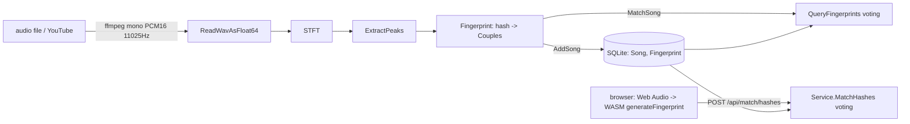

# Repository Guidelines

## Project Overview

AcousticDNA is a Shazam-style audio fingerprinting engine in Go. The pipeline is STFT spectrogram → constellation peaks → combinatorial 32-bit hashes → SQLite → time-offset voting. It has three entry points that share the fingerprint core:

- `cmd/cli`: talks to the SQLite DB directly, with no HTTP.
- `cmd/server`: REST API plus the static frontend in `web/public/`.
- `cmd/wasm`: computes fingerprints in the browser, so the match flow never uploads raw audio.

## Architecture & Data Flow



- **Service layer** (`pkg/acousticdna/service.go`): `acousticService` implements `Service` (`interfaces.go`) with `AddSong`, `MatchSong`, `MatchHashes`, `GetSongByID`, `ListSongs`, `CountFingerprints`, `DeleteSong`, and `Close`. Build it with `NewService(opts ...Option)`. The options in `config.go` are `WithDBPath`, `WithTempDir`, `WithSampleRate`, `WithLogger`, and `WithStorage`. Defaults: `acousticdna.sqlite3`, `/tmp`, `11025`. Options are not validated.
- **Storage**: `storage/sqlite.go` (`DBClient`, gorm models `Song`/`Fingerprint`) ↔ `storage_adapter.go` (`storageAdapter`, mapping to `models.Song`/`models.Couple`) ↔ the `Storage` interface.
  - `Song` uses a UUID string PK and a unique `(Title, Artist)` pair. `RegisterSong` reuses an existing ID and reports `created=false`; `AddSong` then skips fingerprint storage so re-adds never duplicate fingerprints.
  - `Fingerprint` has an indexed `Hash` and `SongID` and no cascade. `DeleteSongByID` deletes fingerprints and then the song inside one transaction.
  - `StoreFingerprints` batches inserts (1000-row flush, `CreateInBatches(…, 500)`). The whole song insert is not wrapped in one transaction.
  - `GetCouplesByHashes` runs **one** batched `hash IN (...)` query. Never add per-hash round trips.
- **Fingerprint core** (`pkg/acousticdna/fingerprint/`, no build tag, shared with WASM):
  - `spectrogram.go`: `WindowSize=1024` and `HopSize=256`, Hamming window, first 512 bins. Only complete frames are used. Input shorter than one window is rejected.
  - `peaks.go`: log-doubling bands, strongest bin per band. A peak must be ≥ avg band-max dB + 3 and a local max within ±3 bins / ±1 frame. Always uses the global `WindowSize`/`HopSize`.
  - `hasher.go`: hash = `[anchorBin:9 | targetBin:9 | deltaMs:14]`, built from shifts 23/14/0. Constants: `FanOut=6`, `MinDeltaMs=10`, `MaxDeltaMs=15000`. Bins must fit 0..511.
  - `generator.go`: `Fingerprint()` sorts peaks in place and returns `map[uint32][]models.Couple`. `QueryFingerprints()` votes on the exact offset `dbAnchorMs - queryAnchorMs` and sorts by `Count` descending. Ties have no fixed order.
- **Matching duplication**: `service.go:MatchHashes` reimplements the voting from `generator.go:QueryFingerprints`, because WASM sends `hash → anchorMs` pairs, not peaks. Change both together. `MatchHashes` takes `map[uint32]uint32`, which allows only one anchor per hash. File matching keeps every anchor.
- **Confidence** (`service.go:calculateConfidence`, `competingScore`): `signal = (peakiness + margin)/2`, passed through a logistic with steepness 9 and midpoint 0.35. When best < 8 votes, the result is damped by `(best/8)^2`. The tests in `service_test.go` lock these constants.
- **HTTP** (`cmd/server/routes.go`, `handlers.go`): stdlib `ServeMux`, middleware order `cors(logging(mux))`, 30 s graceful shutdown.
  - Health: `/health`, `/api/health/metrics`.
  - Songs: `/api/songs`, `/api/songs/{id}`, `/api/songs/youtube`.
  - Match: `/api/match` (multipart audio), `/api/match/hashes` (JSON `{"hashes":{"<uint32>":<anchorMs>}}`).
  - DTOs and validation live in `pkg/models/api.go`.
- **WASM** (`cmd/wasm/main.go`): exports the single global `generateFingerprint(samples, sampleRate, channels)`, which returns `{error, data:[{hash, anchorTime}]}`. It dispatches a `wasmReady` event and does no resampling. `web/public/wasm.js` resamples to mono 11025 Hz before calling it.

## Key Directories

| Path | Purpose |
|---|---|
| `pkg/acousticdna/` | Service, config/options, storage adapter, interfaces |
| `pkg/acousticdna/fingerprint/` | DSP + hashing + voting (shared native/WASM) |
| `pkg/acousticdna/audio/` | ffmpeg conversion (`ConvertToMonoWAV`), PCM16 WAV reader, yt-dlp wrapper |
| `pkg/acousticdna/storage/` | gorm/SQLite client and models |
| `pkg/models/` | `database.go` (voting types), `domain.go` (public types), `api.go` (HTTP DTOs) |
| `pkg/utils/`, `pkg/logger/` | file/UUID/YouTube-ID helpers; `Logger` impl |
| `web/public/` | Single-page frontend (`index.html`, `wasm.js`, `wasm_exec.js`, `fingerprint.wasm`) |
| `web/src/api/wasm.js` | Unused legacy loader. Don't edit it thinking it's live. |
| `refrence_scripts/` | `//go:build ignore` standalone examples. Run them one file at a time. `make-spectorgram.go` won't build: its deps are not in `go.mod`. |
| `test/` | `testCroppedAudio/` (perf clip), `testdata/` WAVs, `spectrograms/`, `yt_url.txt`. Only perf uses fixtures. |
| `docs/` | `EXPLAINED.md`, `INTERVIEW.md` (narrative; some claims overstated) |

## Development Commands

```bash
go mod download
go build ./...                                   # native tree
GOOS=js GOARCH=wasm go build ./cmd/wasm/          # browser tree — run both after touching fingerprint/
go build -o acousticDNA ./cmd/cli/
go build -o server ./cmd/server/
bash scripts/build-wasm.sh                        # wasm + matching wasm_exec.js into web/public/
go vet ./...                                      # no golangci/CI configured

./server -port 8080 -db acousticdna.sqlite3 -temp /tmp -rate 11025 -origins "*"   # run from repo root
./acousticDNA -db catalog.sqlite3 -temp /tmp add song.mp3 --title "Song" --artist "Artist"
./acousticDNA add --youtube-url "<url>"
./acousticDNA match recording.wav
./acousticDNA list
./acousticDNA delete <song-id>

git lfs pull && docker compose up --build         # seeds /data from ./acousticdna.sqlite3 on first boot
```

- The CLI global flags `-db`/`-temp` must come **before** the subcommand.
- Server env vars: `PORT`, `ACOUSTIC_DB_PATH`, `ACOUSTIC_TEMP_DIR`. Flags override them. `.env` is not auto-loaded.
- Serve the frontend through `./server` and open `http://localhost:8080`. The frontend calls `window.location.origin`, so the static servers in the README (python/npx) break the API calls.

## Code Conventions & Common Patterns

- **Build tags**: these files are `//go:build !js && !wasm`: `cmd/{cli,server}`, `pkg/acousticdna/{service,storage_adapter,service_test,perf_test}.go`, `storage/sqlite.go`. `cmd/wasm/main.go` is `js && wasm`. Never import native-only packages (audio, storage, gorm) from `fingerprint/` or `cmd/wasm`.
- **Errors**: wrap at every layer with `fmt.Errorf("context: %w", err)`.
- **Logging**: use the `Logger` interface (printf-style) injected with `WithLogger`. Don't call `log`/`fmt.Println`. The one exception is the server middleware, which uses `logger.GetLogger()`.
- **DI**: functional options. Swap storage with `WithStorage`. `Close()` also closes injected storage.
- **Match result handling**: when a song's metadata lookup fails, the match is logged as a warning and skipped, not returned as an error. All candidates are returned, with no top-N cut.
- **Keep in sync**: the two voting loops, the hash constants, and the sample rate (CLI hardcodes 11025, server `-rate`, browser resample 11025). Also the match DTO mapping in both handlers. A sample-rate mismatch between indexing and query silently breaks matching.
- **External tools**: shell out via `exec` (`ffmpeg`, `yt-dlp`). Conversion has a default 10 s deadline. yt-dlp is configured by `YTDLP_COOKIES_FROM_BROWSER`, `YTDLP_JS_RUNTIMES`, `YTDLP_REMOTE_COMPONENTS`, and `YTDLP_EXTRA_ARGS`. `YTDLP_EXTRA_ARGS` is split with `strings.Fields`, so quoting is not honored.
- Converted temp files are named after the input basename in `TempDir`. Concurrent conversions of inputs with the same basename collide.

## Important Files

- Entry points: `cmd/cli/main.go`, `cmd/server/main.go` (+ `routes.go`, `handlers.go`), `cmd/wasm/main.go`.
- Core: `pkg/acousticdna/{interfaces,config,service,storage_adapter}.go`, `pkg/acousticdna/fingerprint/*.go`.
- Config/deploy: `go.mod` (Go **1.26.10**), `Dockerfile` (multi-stage: builder → static ffmpeg → bookworm-slim runtime, UID 10001), `docker-compose.yml` (read-only rootfs, `/tmp:exec` tmpfs required by yt-dlp, 512M), `docker-entrypoint.sh` (seeds the DB only when absent and when the file has SQLite magic), `.gitattributes` (`*.sqlite3` → LFS).
- `acousticdna.sqlite3`: demo DB tracked in LFS. If it is an un-pulled pointer, perf tests fail and Docker starts with an empty DB.

## Runtime/Tooling Preferences

- Go 1.26.10 modules only. No Makefile, Taskfile, CI workflows, or lint config. Frontend has no npm, bundler, or lockfile.
- SQLite must stay **CGO-free** (`glebarez/sqlite` + gorm, built with `CGO_ENABLED=0`). Never swap in `mattn/go-sqlite3`.
- FFT comes from `github.com/madelynnblue/go-dsp`.
- Native audio needs `ffmpeg` and `yt-dlp` on PATH. Code never calls `ffprobe`, despite the README.
- `wasm_exec.js` must match the Go toolchain that built the `.wasm`. A raw `go build` for WASM does not refresh it; `scripts/build-wasm.sh` does.

## Testing & QA

- Stdlib `testing` only: table-driven `t.Run`, `t.Setenv`, `httptest`. No testify or mocks. No test uses `WithStorage` fakes; `service_test.go` builds `&acousticService{}` directly.
- Coverage by file:
  - `fingerprint/generator_test.go`: voting and sorting, on synthetic couples.
  - `service_test.go`: confidence math and thresholds (genuine > 60%, noise < 25%).
  - `audio/processor_test.go`: yt-dlp args, artist fallback.
  - `cmd/server/routes_test.go`: CORS only.
  - `cmd/server/main_test.go`: env parsing.
- Known gaps: no test compares `MatchHashes` with `QueryFingerprints`, no endpoint tests, and no native/WASM parity test.

```bash
go test ./...
go test ./pkg/acousticdna/fingerprint -run '^TestQueryFingerprints$' -v
go test ./pkg/acousticdna -run '^TestCalculateConfidence' -v
go test ./pkg/acousticdna -run '^TestPerfClaims$' -count=1 -v   # needs LFS DB + test/testCroppedAudio/bruatiful_test.wav + ffmpeg
```

- `TestPerfClaims` logs performance estimates without enforcing performance/accuracy thresholds; it fails on DB-open, zero-hash, and SQL errors. Any ffmpeg conversion error is reported as a skip. It opens the real DB with `AutoMigrate`, so it can write.
- No coverage threshold exists. When changing `fingerprint/`, run both builds and `go test ./...`. When touching confidence constants, update `service_test.go` on purpose.
